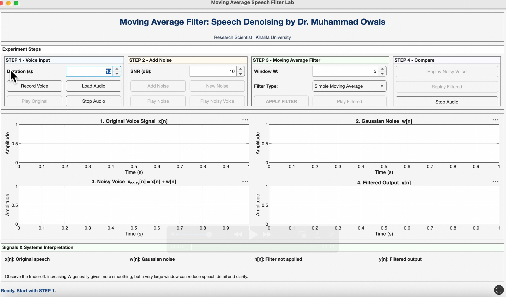

<div align="center">

# Moving Average Speech Lab

### Interactive MATLAB GUI for Speech Filtering and Signal Smoothing

**Muhammad Owais**  
Research Scientist | Khalifa University, UAE  
*Signals and Systems for Robotics*

[](https://www.mathworks.com/products/matlab.html)
[](#learning-objectives)
[](#classroom-exercise)

**Record a voice sample, add noise, apply a moving-average filter, and hear the difference.**



[Get started](#quick-start) · [Explore the theory](#signals-and-systems-foundations) · [Try the lab](#classroom-exercise) · [Source code](MovingAverageSpeechLabByOwais.m)

</div>

---

## Overview

**Moving Average Speech Lab** is an interactive MATLAB teaching tool that introduces finite impulse response (FIR) filtering through a familiar signal: a recorded voice. It connects concepts from **Signals and Systems** to a practical experiment in noise, smoothing, convolution, and filter design.

Students can start by using the GUI without writing code, then inspect and modify the MATLAB source as their understanding develops.

### Learning objectives

By completing the demonstration, students should be able to:

1. Identify input, noise, impulse response, and output signals.
2. Explain how signal-to-noise ratio (SNR) changes the perceived noise level.
3. Describe moving-average filtering using a difference equation, an impulse response, and convolution.
4. Compare uniform and weighted averaging and predict how window size affects smoothing.
5. Explain the trade-off between suppressing rapid fluctuations and preserving speech detail.
6. Connect an interactive experiment to its MATLAB implementation.

## Features

| Feature | Description |
| --- | --- |
| Voice input | Record speech through a microphone or load an audio file. |
| Configurable noise | Add Gaussian noise with a target SNR from **-5 to 40 dB**. |
| Signal displays | View original speech, generated noise, noisy speech, and filtered output. |
| Two filter modes | Select a **simple** or **weighted** moving average. |
| Window control | Change the filter length from **3 to 10 samples**. |
| Audio comparison | Play and compare the original, noise, noisy, and filtered signals. |
| Coefficient display | Inspect the FIR coefficients used by the selected filter. |
| Source-code access | Explore and modify the MATLAB implementation. |

## Quick start

**Requirements:** MATLAB with support for App Designer-style UI components (`uifigure`, `uigridlayout`, and related functions). A microphone is needed only for recording; a speaker or headphones are needed for listening. Compatibility has not been formally tested across MATLAB releases.

1. [Download this repository](https://github.com/Owais-CodeHub/SpeechLab/archive/refs/heads/main.zip) and extract it, or clone it:

   ```bash
   git clone https://github.com/Owais-CodeHub/SpeechLab.git
   ```

2. Open MATLAB and change the current folder to the downloaded repository.
3. Run the following command in the MATLAB Command Window:

   ```matlab
   MovingAverageSpeechLabByOwais
   ```

4. Follow the four steps displayed in the GUI.

> **Tip:** Start with a short voice sample of approximately 10–15 seconds. If you are unable to record, try loading an existing audio file.

## Four-step experiment

| Step | Action | What to observe |
| --- | --- | --- |
| **1. Voice input** | Record or load speech. | The original waveform and playback. |
| **2. Add noise** | Choose an SNR and click **Add Noise**. | The difference between the original and noisy speech. |
| **3. Apply filter** | Set a window size, choose a filter mode, and click **APPLY FILTER**. | How the filtered waveform and sound change. |
| **4. Compare** | Replay noisy and filtered speech. | Noise reduction versus loss of speech detail. |

### Signal-processing pipeline

```text
Original speech x[n] ------+
                           | (+) --> Noisy speech x_noisy[n]
Gaussian noise w[n] -------+                   |
                                               v
                                  FIR moving-average filter h[n]
                                               |
                                               v
                                        Output y[n]
                                               |
                                               v
                                  Listen and compare waveforms
```

## Signals and Systems foundations

### 1. Noisy speech and SNR

The noise-corrupted speech signal is

$$
x_{\mathrm{noisy}}[n] = x[n] + w[n],
$$

where $x[n]$ is the original speech and $w[n]$ is additive Gaussian noise. The signal-to-noise ratio in decibels is

$$
\mathrm{SNR}_{\mathrm{dB}}=10\log_{10}\left(\frac{P_x}{P_w}\right),
$$

where $P_x$ and $P_w$ denote the respective average signal and noise powers. **Lower SNR** generally means a noisier recording; **higher SNR** generally means cleaner speech.

### 2. Simple moving-average filter

A causal, $W$-sample moving average is

$$
y[n] = \frac{1}{W}\sum_{k=0}^{W-1}x_{\mathrm{noisy}}[n-k].
$$

For $W=3$,

$$
y[n]=\frac{x_{\mathrm{noisy}}[n]+x_{\mathrm{noisy}}[n-1]+x_{\mathrm{noisy}}[n-2]}{3}.
$$

Its impulse-response coefficients are

$$
h=[1/3,\;1/3,\;1/3].
$$

The same system can be expressed as discrete-time convolution:

$$
y[n]=(x_{\mathrm{noisy}}*h)[n]
     =\sum_{k=0}^{W-1}h[k]x_{\mathrm{noisy}}[n-k].
$$

### 3. Weighted moving-average filter

Unlike the uniform filter, the weighted filter emphasizes more recent samples. **In the current MATLAB implementation**, the unnormalized weights are $W,W-1,\ldots,1$ and are divided by their sum.

For $W=3$,

$$
h=[3/6,\;2/6,\;1/6],
$$

so

$$
y[n]=\frac{3}{6}x_{\mathrm{noisy}}[n]
+\frac{2}{6}x_{\mathrm{noisy}}[n-1]
+\frac{1}{6}x_{\mathrm{noisy}}[n-2].
$$

This lets students compare equal weighting with a filter that assigns greater weight to recent observations.

### 4. Window size and smoothing

| Window length | Typical effect |
| --- | --- |
| **3 samples** | Mild smoothing; relatively more high-frequency detail retained. |
| **5 samples** | Increased smoothing. |
| **10 samples** | Stronger suppression of rapid variations, with a greater possibility of speech distortion. |

For a fixed sampling rate, increasing the moving-average window generally increases smoothing. The audible result also depends on the input speech, noise level, and filter type.

**Important limitation:** A moving average is a simple low-pass filter, not a general-purpose speech enhancement system. It may reduce some high-frequency noise, but broadband noise can remain, and useful speech frequencies may also be attenuated. A longer window does **not** guarantee better speech quality.

### 5. Initial conditions and output length

The implementation uses causal FIR filtering with zero initial conditions. Samples before the start of the input are assumed to be zero. For example, at $W=3$:

$$
y[0]=\frac{x_{\mathrm{noisy}}[0]+0+0}{3}.
$$

MATLAB's `filter(h, 1, input)` returns an output with the **same number of samples** as its input. The zero initial conditions can affect the first few output samples.

## Classroom exercise

**Goal:** Investigate the relationship among SNR, window size, filter coefficients, and perceived speech quality.

1. **Capture the input.** Record 10–15 seconds of speech (or load an audio file). Listen to the clean input and inspect its waveform.
2. **Introduce noise.** Set **SNR = 10 dB** and add Gaussian noise. Listen and compare the original and noisy recordings.
3. **Test window sizes.** Keep the noisy input unchanged and apply the **simple moving average** with $W=3$, $5$, and $10$. Record your observations for each setting.
4. **Compare filter modes.** At the same window size, compare the simple and weighted moving averages. Inspect the displayed coefficients.
5. **Explore SNR.** Repeat with a lower SNR (e.g., **0 dB**) and a higher SNR (e.g., **20 dB**). Describe how the filtering outcome changes.
6. **Inspect the source.** Open `MovingAverageSpeechLabByOwais.m`, locate the FIR coefficient definitions and `filter` operation, and explain how these relate to the equations above.

> **Fair comparison:** Keep the same speech recording and the same noisy signal while comparing window sizes or filter types. Generating new random noise between trials can make comparisons less meaningful.

### Reflection questions

1. What do $x[n]$, $w[n]$, $x_{\mathrm{noisy}}[n]$, $h[n]$, and $y[n]$ represent in this experiment?
2. What is the mathematical difference between a 3-point and a 5-point simple moving-average filter?
3. As the window grows from 3 to 10, what changes do you hear? Do those changes always improve speech intelligibility?
4. Why can a moving-average filter reduce rapid fluctuations while also suppressing useful speech components?
5. How do the coefficients differ between simple and weighted moving averages for the same $W$?
6. How does reducing the input SNR affect the noisy signal and the filtered result?
7. How does the difference equation connect to the impulse response and convolution operation?
8. Why are initial conditions relevant at the start of causal filtering?

### Optional source-code challenge

Modify the coefficients of a weighted filter, keeping their sum equal to one. Predict how the response will change, run the experiment, and compare the result with your prediction. Explain the outcome using the impulse response.

## Repository structure

```text
SpeechLab/
├── MovingAverageSpeechLabByOwais.m  # MATLAB GUI and signal-processing code
├── gui.png                           # GUI screenshot
└── README.md                         # Documentation
```

## Teaching applications

Suitable for **Signals and Systems**, **Digital Signal Processing**, **robotics**, introductory **FIR filtering**, **convolution**, **difference equations**, and MATLAB-based laboratory instruction.

This resource is intended primarily for **conceptual demonstration and hands-on learning**, rather than production-quality speech denoising.

## Citation

If you use the tool in teaching material, presentations, or research, please acknowledge the repository:

> M. Owais, *Moving Average Speech Lab: Interactive MATLAB GUI for Speech Filtering and Signal Smoothing*, educational software, 2026. https://github.com/Owais-CodeHub/SpeechLab

```bibtex
@software{owais2026speechlab,
  author = {Owais, Muhammad},
  title = {Moving Average Speech Lab: Interactive MATLAB GUI for Speech Filtering and Signal Smoothing},
  year = {2026},
  url = {https://github.com/Owais-CodeHub/SpeechLab},
  note = {MATLAB educational software}
}
```

## Author

**Muhammad Owais**  
Research Scientist, Khalifa University, Abu Dhabi, UAE  
Course context: *Signals and Systems for Robotics*

**Repository:** https://github.com/Owais-CodeHub/SpeechLab

---

<div align="center">

**Explore · Understand · Experiment · Modify · Learn**

If this resource is useful, consider starring the repository.

</div>
